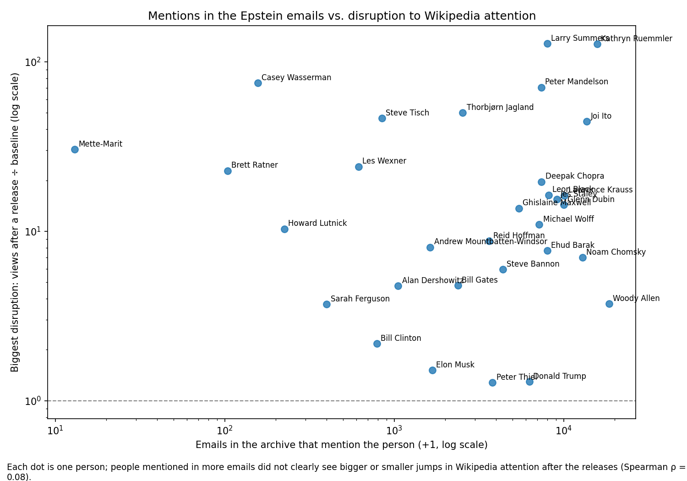
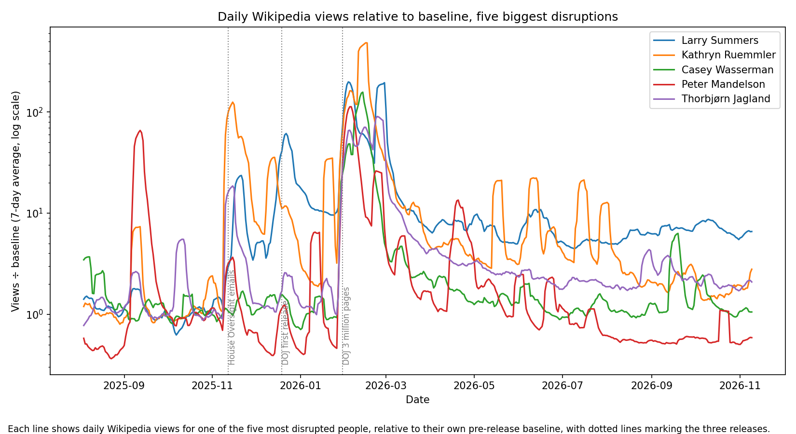

# Who Wikipedia Watched: Attention After the Epstein Files

**Daphnne Chacon**

## Summary

When the Epstein files were released between November 2025 and January 2026, which public figures named in them suddenly got more public attention, and did it last? This project measures disruption as the jump in daily Wikipedia pageviews after each release, compared with each person's normal level. It asks who had the biggest disruptions, whether people mentioned more often in the released emails were disrupted more, and whether their Wikipedia articles still mention Epstein today or whether those mentions were removed. The proposal is in [proposal.md](proposal.md).

## Data

**Sources.** The Jmail email archive (`https://data.jmail.world/v1/emails.parquet`), downloaded once; the Wikimedia Pageviews API (daily views by human readers, August 1, 2025 through the collection date); and the MediaWiki Action API (current article titles and the article text on November 11, 2025, March 1, 2026, and today). Every Wikimedia request uses an identifying User-Agent and pauses one second.

**Collected.** November 14, 2026, using `notebooks/02_collect_and_clean.ipynb`.

**Records.** 31 public figures. The archive held 1,780,692 emails; after removing the two hacked sets (the Yahoo emails and Ehud Barak's emails published by DDoSecrets) and promotional mail, 1,748,681 remain. The clean daily pageview table has 14,539 rows.

**What is in the repo.** The full cleaned data in `data/clean/`, documented in [data/README.md](data/README.md).

**What I left out and why.** The raw email archive is not committed. It is about 330 MB, too large for GitHub, and it contains names and email addresses of private individuals, possibly including victims. Only the count of emails mentioning each public figure is kept. Raw API responses are also left out, because anyone can rebuild them by running the notebook.

Wikipedia pageview and article data come from the Wikimedia Foundation and are reused under its open licenses.

## Methods

For each person, the baseline is their median daily pageviews over the 60 days before the first release (September 13 to November 11, 2025). For each of the three releases (House Oversight emails on November 12, 2025, the first DOJ release on December 19, 2025, and the DOJ release of over 3 million pages on January 30, 2026), disruption is their average daily views over the next 14 days divided by the baseline. A person's biggest disruption is the largest of the three.

Email mentions are the number of emails (subject, participants, or body) matching a search pattern for each person, after removing the hacked sets and promotional mail. I compare mentions with biggest disruption using a Spearman rank correlation.

To check whether articles were scrubbed, I count how many times "Epstein" appears in each article before the first release, on March 1, 2026, and today, and check whether the article has a section heading about Epstein. The analysis is in `notebooks/03_analysis.ipynb`.

## Findings (preliminary)



*Each dot is one person; people mentioned in more emails did not clearly see bigger or smaller jumps in Wikipedia attention after the releases (Spearman ρ = 0.08).*

The biggest disruptions were Larry Summers (128 times his normal daily views), Kathryn Ruemmler (127 times) and Casey Wasserman (75 times), all after the DOJ's January 30, 2026 release of over 3 million pages. That release caused more people's biggest disruption than either earlier release.

Being mentioned more often in the emails did not predict a bigger disruption (Spearman ρ = 0.08, essentially no relationship). This suggests that how much attention someone got depended more on news coverage of what the files said about them than on how often their name appeared.

There is no sign of scrubbing so far. Today, 30 of 31 articles mention Epstein, 25 have a section heading about him, and none mention him less than half as often as they did in March 2026.



*Each line shows daily Wikipedia views for one of the five most disrupted people, relative to their own pre-release baseline, with dotted lines marking the three releases.*

## How to reproduce

```
pip install -r requirements.txt
```

Run `notebooks/02_collect_and_clean.ipynb` (about 10 minutes), then `notebooks/03_analysis.ipynb`.

## AI Use

I used AI to help me format my thoughts into the proposal and to help write the collection, cleaning, and analysis code.

Started as a project for a web data science course at CU Boulder.
